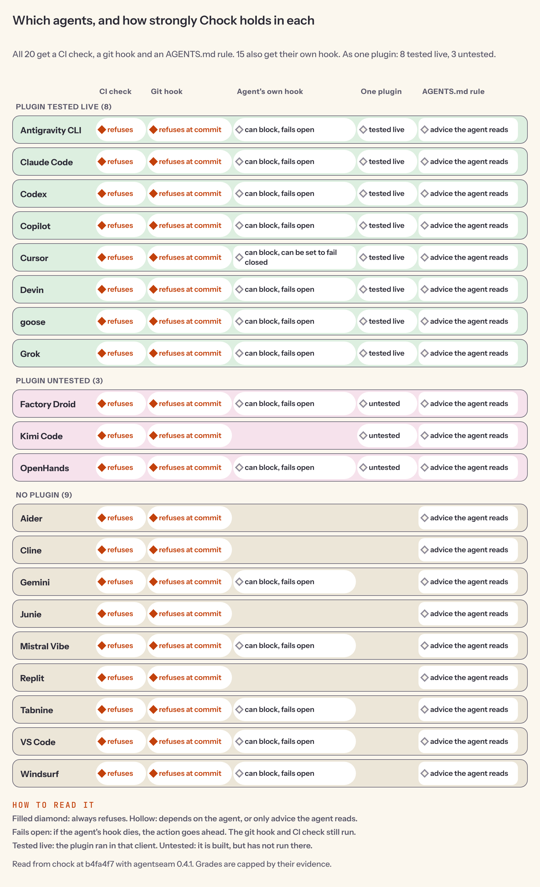

# Adapters

Adapters map the agent-agnostic Chock core to agent-specific surfaces.

## Which agents, and how strongly

The picture is derived from the code by `python docs/assets/readme/derive.py readme`, so a change to an agent moves it.

## Agent-specific entry points

Most agents read `AGENTS.md` directly and get **no wrapper file at all** — Cursor, Codex,
Copilot, VS Code, Gemini CLI, Windsurf and Kimi Code among them. A wrapper is written only for
an agent that cannot read the shared file. `chock init . --agent-agnostic` writes exactly
these, and nothing else:

- Claude Code: `CLAUDE.md` (repo root)
- Aider: `CONVENTIONS.md` + `.aider.conf.yml`
- Antigravity CLI: `.agents/rules/agentseam.md`
- Devin: `.devin/README.md`
- Grok Build: `.grok/GROK.md`
- Junie: `.junie/guidelines.md`
- Replit Agent: `replit.md`
- Tabnine: `guidelines.md`

These files are thin wrappers. The actual rules and skills live in `AGENTS.md`,
`.agents/policies/INDEX.md`, `.agents/skills/` and `.agents/policies/`.

## Contents

- [Claude](./claude.md)
- [Cursor](./cursor.md)
- [Devin](./devin.md)
- [Windsurf](./windsurf.md)
- [Codex](./codex.md)
- [GitHub Copilot](./github.md)
- [Gemini CLI](./gemini.md)
- [Grok Build](./grok.md)
- [Kimi Code](./kimi.md)
- [Aider](./aider.md)
- [VS Code](./vscode.md)
- [Replit Agent](./replit.md)
- [Tabnine](./tabnine.md)
- [Antigravity CLI](./antigravity.md)
- [The skills bridge — why only Claude Code](./skills-bridge.md)
